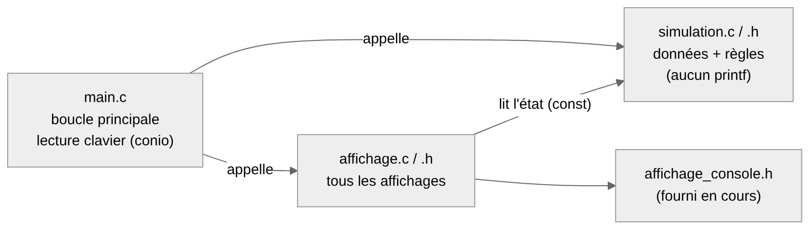
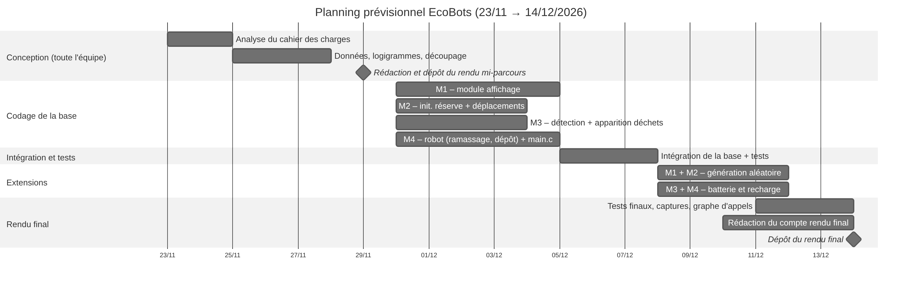
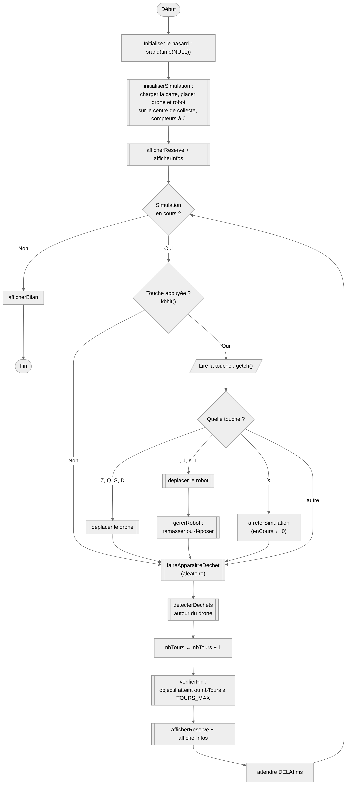
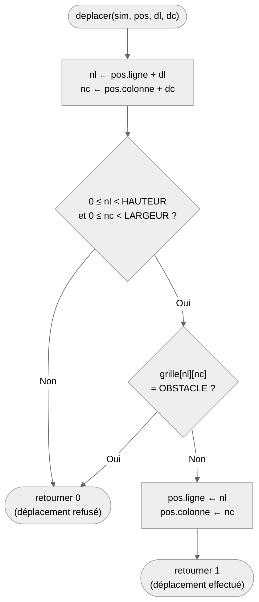
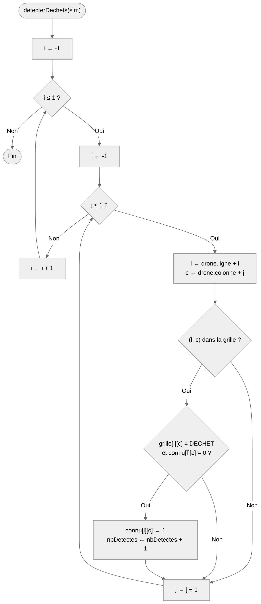
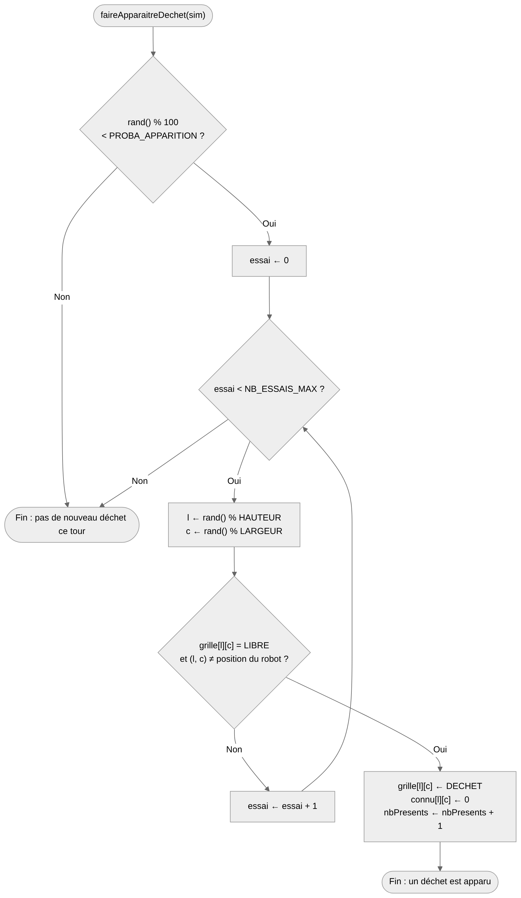
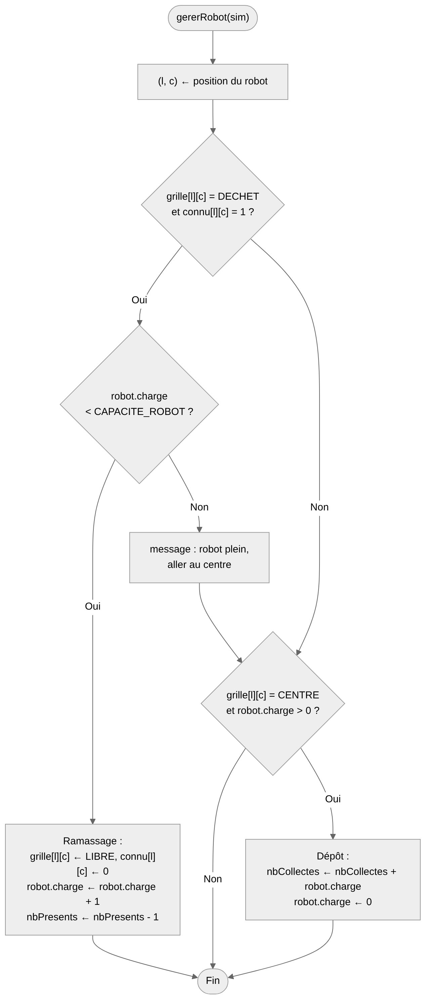
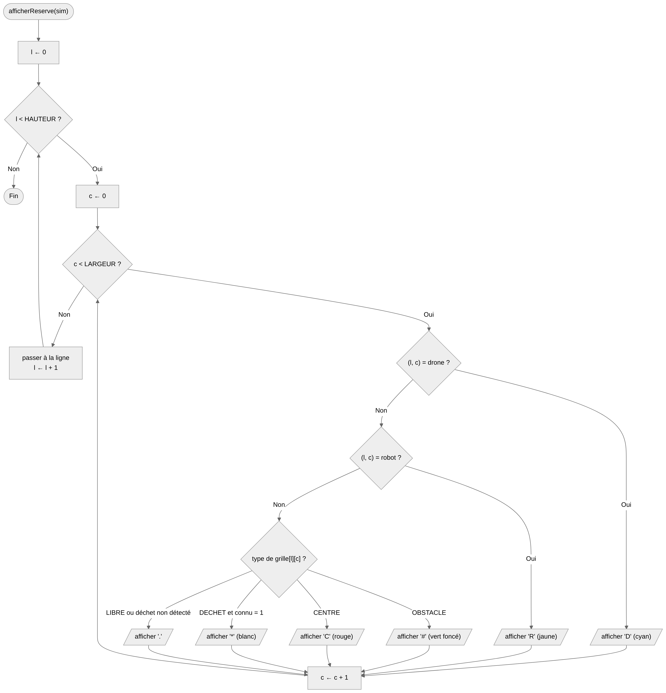

> *Remarque : les noms « Membre 1 » à « Membre 4 » sont provisoires et doivent être remplacés par les noms des membres de l'équipe avant le dépôt. Si l'équipe compte trois membres, les tâches de Membre 4 sont réparties entre les autres.*

# 1. Introduction

Le but du projet est de simuler, en langage C et en mode console, la surveillance d'une réserve naturelle. Un **drone** survole la réserve pour **détecter** les déchets laissés par les visiteurs, puis un **robot** tout terrain va les **ramasser** et les **rapporter** à un centre de collecte. Les deux engins sont pilotés au clavier.

Ce document présente notre démarche de conception pour la simulation de base :

1. le planning prévisionnel et la répartition des tâches ;
2. le logigramme global de la simulation ;
3. les tableaux des principales données et de leurs types ;
4. les logigrammes des principaux algorithmes ;
5. les deux extensions que nous proposons.

## 1.1 Règles retenues (lecture du cahier des charges)

Certains points du sujet laissent un choix. Voici les règles que nous avons fixées :

- La réserve est une grille de **20 lignes × 40 colonnes**. Chaque case est soit libre, soit un obstacle, soit le centre de collecte, soit un déchet.
- Pour la version de base, la carte (obstacles et centre) est **écrite en dur** dans le programme sous forme d'un tableau de chaînes de caractères. Sa génération aléatoire est l'objet de l'extension 1.
- Le **drone** et le **robot** démarrent sur le centre de collecte. Ils peuvent aller sur toutes les cases sauf les obstacles et ne sortent jamais de la grille. Le drone vole : il peut être sur la même case que le robot.
- Un déchet présent mais **pas encore détecté** est invisible à l'écran : il est affiché comme une case libre. Il devient visible (et sa position connue) quand le drone passe sur sa case ou sur l'une des 8 cases voisines.
- Le robot **ramasse automatiquement** un déchet détecté quand il arrive sur sa case, dans la limite de sa capacité (**3 déchets**). Il **dépose automatiquement** son chargement quand il arrive sur le centre de collecte. Il ne peut pas ramasser un déchet non détecté.
- À chaque tour de boucle, un nouveau déchet peut apparaître sur une case libre avec une probabilité de **5 %**.
- La simulation s'arrête quand l'utilisateur appuie sur **X**, quand l'objectif de **20 déchets collectés** est atteint, ou après **3 000 tours**.

| Touche | Action |
|---|---|
| Z / Q / S / D | déplacer le drone (haut / gauche / bas / droite) |
| I / J / K / L | déplacer le robot (haut / gauche / bas / droite) |
| X | quitter la simulation |

## 1.2 Découpage en modules

Comme demandé, l'affichage est séparé de la logique de la simulation :

- **simulation.c / simulation.h** : types, constantes et sous-programmes qui modifient l'état de la simulation (déplacements, détection, apparition, ramassage, fin). Ce module ne fait **aucun affichage** ni aucune saisie.
- **affichage.c / affichage.h** : tous les sous-programmes d'affichage. Ils reçoivent la simulation en lecture seule (`const Simulation *`) et utilisent le module `affichage_console.h` fourni en cours (positionnement du curseur, couleurs).
- **main.c** : programme principal, avec la boucle de simulation et la lecture non bloquante du clavier (`kbhit()` et `getch()` de `<conio.h>`). Il traduit chaque touche en appel d'un sous-programme de simulation.

Ainsi, on pourrait remplacer l'affichage console par un affichage graphique sans modifier `simulation.c`.

{width=15cm}

# 2. Planning prévisionnel et répartition des tâches

Le projet va de la semaine du 23/11/2026 (rendu de mi-parcours) au 14/12/2026 (rendu final).

{width=17cm}

| Période | Membre 1 | Membre 2 | Membre 3 | Membre 4 |
|---|---|---|---|---|
| 23/11 – 29/11 | Analyse du sujet, logigramme global | Tableaux des données, types | Logigrammes détection et apparition | Logigrammes déplacement et robot, mise en page du rendu |
| 30/11 – 04/12 | Module `affichage` : grille, couleurs, panneau d'informations, bilan | `initialiserSimulation`, `deplacer` | `detecterDechets`, `faireApparaitreDechet` | `gererRobot`, `verifierFin`, `main.c` (boucle et clavier) |
| 05/12 – 07/12 | Intégration et tests (toute l'équipe) | Intégration et tests | Intégration et tests | Intégration et tests |
| 08/12 – 11/12 | Extension 1 : génération aléatoire (affichage) | Extension 1 : génération aléatoire (algorithme) | Extension 2 : batterie (drone) | Extension 2 : batterie (robot, stations) |
| 11/12 – 14/12 | Captures d'écran commentées | Graphe d'appels final | Tests finaux | Coordination du compte rendu final |

Chaque membre teste ses sous-programmes au fur et à mesure avec un petit programme de test avant l'intégration. Le code est partagé sur un dépôt Git commun, et l'équipe fait un point rapide à chaque séance de TD pour vérifier l'avancement par rapport au planning.

# 3. Analyse globale de la simulation

Le programme principal initialise la simulation puis répète une boucle jusqu'à la fin. La lecture du clavier est **non bloquante** : si aucune touche n'est appuyée, la simulation continue quand même (des déchets peuvent apparaître). Une courte pause à la fin de chaque tour évite que la boucle tourne trop vite.

{height=21cm}

# 4. Principales données

## 4.1 Constantes

| Nom | Valeur | Type | Rôle |
|---|---|---|---|
| `HAUTEUR` | 20 | `#define` (entier) | nombre de lignes de la grille |
| `LARGEUR` | 40 | `#define` (entier) | nombre de colonnes de la grille |
| `CAPACITE_ROBOT` | 3 | `#define` (entier) | nombre maximum de déchets transportés par le robot |
| `PROBA_APPARITION` | 5 | `#define` (entier) | chance (en %) qu'un déchet apparaisse à chaque tour |
| `NB_ESSAIS_MAX` | 50 | `#define` (entier) | nombre d'essais pour trouver une case libre |
| `OBJECTIF_COLLECTE` | 20 | `#define` (entier) | nombre de déchets à collecter pour gagner |
| `TOURS_MAX` | 3000 | `#define` (entier) | durée maximale de la simulation (en tours) |
| `DELAI` | 100 | `#define` (entier) | pause entre deux tours, en millisecondes |

## 4.2 Types définis

| Type | Définition en C | Description |
|---|---|---|
| `TypeCase` | `typedef enum { LIBRE, OBSTACLE, CENTRE, DECHET } TypeCase;` | contenu d'une case de la réserve |
| `Position` | `typedef struct { int ligne; int colonne; } Position;` | coordonnées d'une case |
| `Drone` | `typedef struct { Position pos; int nbDeplacements; } Drone;` | drone de surveillance |
| `Robot` | `typedef struct { Position pos; int charge; int nbDeplacements; } Robot;` | robot de collecte ; `charge` = nombre de déchets transportés (0 à `CAPACITE_ROBOT`) |
| `Simulation` | voir tableau 4.3 | regroupe tout l'état de la simulation |

## 4.3 Contenu de la structure `Simulation`

| Champ | Type | Description |
|---|---|---|
| `grille` | `TypeCase grille[HAUTEUR][LARGEUR]` | carte de la réserve |
| `connu` | `int connu[HAUTEUR][LARGEUR]` | 1 si le déchet de cette case a été détecté par le drone, 0 sinon |
| `centre` | `Position` | position du centre de collecte |
| `drone` | `Drone` | état du drone |
| `robot` | `Robot` | état du robot |
| `nbPresents` | `int` | nombre de déchets actuellement dans la réserve (détectés ou non) |
| `nbDetectes` | `int` | nombre total de déchets détectés depuis le début |
| `nbCollectes` | `int` | nombre total de déchets déposés au centre |
| `nbTours` | `int` | nombre de tours de boucle effectués |
| `enCours` | `int` | 1 tant que la simulation continue, 0 pour l'arrêter |

## 4.4 Variables locales du programme principal

| Nom | Type | Rôle |
|---|---|---|
| `sim` | `Simulation` | état complet de la simulation, passé par adresse aux sous-programmes |
| `touche` | `char` | dernière touche lue avec `getch()` |

## 4.5 Sous-programmes prévus

| Module | Prototype | Rôle |
|---|---|---|
| simulation | `void initialiserSimulation(Simulation *sim);` | charge la carte, place drone et robot sur le centre, met les compteurs à 0 |
| simulation | `int deplacer(const Simulation *sim, Position *pos, int dl, int dc);` | déplace une position d'une case si c'est possible ; retourne 1 si le déplacement a eu lieu |
| simulation | `void deplacerDrone(Simulation *sim, int dl, int dc);` | appelle `deplacer` pour le drone |
| simulation | `void deplacerRobot(Simulation *sim, int dl, int dc);` | appelle `deplacer` pour le robot puis `gererRobot` |
| simulation | `void detecterDechets(Simulation *sim);` | marque comme connus les déchets sur la case du drone et ses 8 voisines |
| simulation | `void faireApparaitreDechet(Simulation *sim);` | fait apparaître (ou non) un déchet sur une case libre au hasard |
| simulation | `void gererRobot(Simulation *sim);` | ramassage d'un déchet détecté ou dépôt au centre |
| simulation | `void verifierFin(Simulation *sim);` | met `enCours` à 0 si l'objectif ou `TOURS_MAX` est atteint |
| simulation | `void arreterSimulation(Simulation *sim);` | arrêt demandé par l'utilisateur |
| affichage | `void afficherReserve(const Simulation *sim);` | dessine la grille avec drone, robot et déchets détectés |
| affichage | `void afficherInfos(const Simulation *sim);` | affiche les compteurs, la charge du robot et les touches |
| affichage | `void afficherBilan(const Simulation *sim);` | affiche le résultat à la fin |
| affichage | `void attendre(int ms);` | pause entre deux tours (utilise le module fourni) |
| main | `int main(void);` | boucle principale et lecture du clavier |

## 4.6 Représentation à l'écran

| Élément | Caractère | Couleur prévue |
|---|---|---|
| case libre (ou déchet non détecté) | `.` | gris |
| obstacle | `#` | vert foncé |
| centre de collecte | `C` | rouge |
| déchet détecté | `*` | blanc |
| drone | `D` | cyan |
| robot | `R` | jaune |

# 5. Principaux algorithmes

## 5.1 Déplacement du drone ou du robot

Le même sous-programme sert pour les deux engins. `dl` et `dc` valent -1, 0 ou 1 selon la touche (par exemple Z donne `dl = -1, dc = 0`). Le déplacement est refusé si la case visée est hors de la grille ou si c'est un obstacle.

{height=12cm}

## 5.2 Détection des déchets

On parcourt les 9 cases du carré 3 × 3 centré sur le drone. Il faut vérifier que chaque case est bien dans la grille, car le drone peut être au bord.

{height=17cm}

## 5.3 Apparition aléatoire d'un déchet

À chaque tour, on tire un nombre entre 0 et 99. S'il est inférieur à `PROBA_APPARITION`, on cherche au hasard une case libre (sans le robot dessus). On limite le nombre d'essais pour ne pas boucler indéfiniment si la grille est presque pleine.

{height=17cm}

## 5.4 Ramassage et dépôt par le robot

Ce sous-programme est appelé après chaque déplacement du robot.

{height=17cm}

## 5.5 Affichage de la réserve

L'affichage parcourt la grille ligne par ligne. Pour chaque case, le drone est prioritaire sur le robot, et le robot sur le contenu de la case. Seuls les déchets détectés sont visibles.

{width=16cm}

# 6. Extensions proposées

*Ces extensions sont des propositions : elles ne seront développées qu'une fois la simulation de base entièrement fonctionnelle.*

## 6.1 Extension 1 : génération « aléatoire » de la réserve

Au lieu d'utiliser une carte fixe, le programme crée une nouvelle réserve à chaque partie :

1. toutes les cases sont mises à `LIBRE` ;
2. on place quelques « graines » d'obstacles au hasard, puis on agrandit chacune en ajoutant des obstacles sur des cases voisines tirées au hasard, pour obtenir des zones (forêts, lacs) plutôt que des cases isolées ;
3. on limite les obstacles à environ 20 % de la grille ;
4. on place le centre de collecte sur une case libre tirée au hasard ;
5. on vérifie que le centre n'est pas enfermé : depuis le centre, on « propage » une marque sur les cases libres voisines (parcours de proche en proche). Si trop de cases libres ne sont pas atteintes, on recommence la génération.

Données supplémentaires : `#define TAUX_OBSTACLES 20`, `#define NB_GRAINES 8`, un tableau `int atteint[HAUTEUR][LARGEUR]` pour la vérification. Nouveau sous-programme : `void genererReserve(Simulation *sim);` dans le module simulation.

## 6.2 Extension 2 : batterie du drone et du robot, stations de recharge

- On ajoute un champ `int batterie;` (de 0 à 100) dans `Drone` et dans `Robot`.
- Chaque déplacement consomme de la batterie (par exemple 1 point pour le drone, 2 points pour le robot quand il est chargé).
- Une batterie à 0 empêche l'engin de bouger.
- On ajoute un type de case `STATION` dans `TypeCase` : un engin posé sur une station se recharge de 10 points par tour. Le centre de collecte sert aussi de station.
- Le panneau d'informations affiche le niveau de batterie, avec une alerte en dessous de 20 %.

Données supplémentaires : `#define BATTERIE_MAX 100`, `#define RECHARGE 10`, `#define SEUIL_ALERTE 20`. Nouveaux sous-programmes : `void consommerBatterie(int *batterie, int cout);` et `void rechargerEngins(Simulation *sim);`, appelé à chaque tour dans la boucle principale.

# 7. Conclusion

Cette conception fixe les règles de la simulation, les données et leurs types, et le découpage en sous-programmes et en modules. Elle nous permet de répartir le codage entre les membres de l'équipe dès la semaine du 30/11. Les éventuelles modifications de cette solution seront indiquées dans le compte rendu final.
